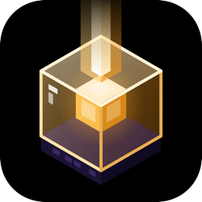

# BeaconSync

Git-like modpack manager for Minecraft. Build a pack, save versions, branch, roll back, publish,
and deploy it to one or many servers that update and restart themselves. Players get notified in
game when a new version is out.

> Alpha. Everything below works end to end, but expect rough edges. Please report bugs.

Runs on **macOS, Windows and Linux**. Tested end to end with a real Minecraft 26.3 Fabric pack:
Windows client, macOS client, Linux servers (systemd and Docker).

| Windows | macOS |
| --- | --- |
| 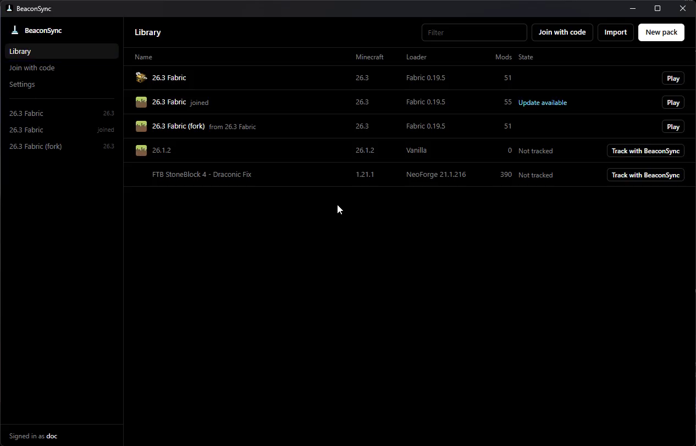 | 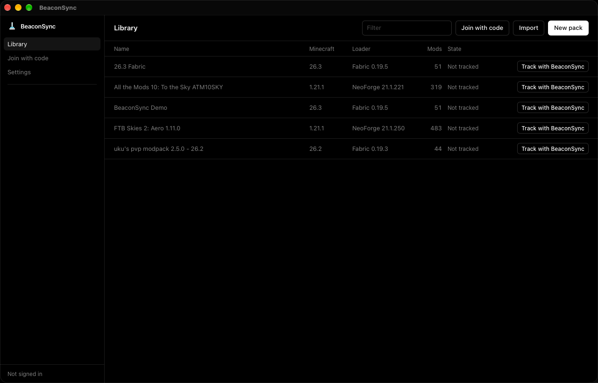 |

| Changes | History and branches | Deploy |
| --- | --- | --- |
| 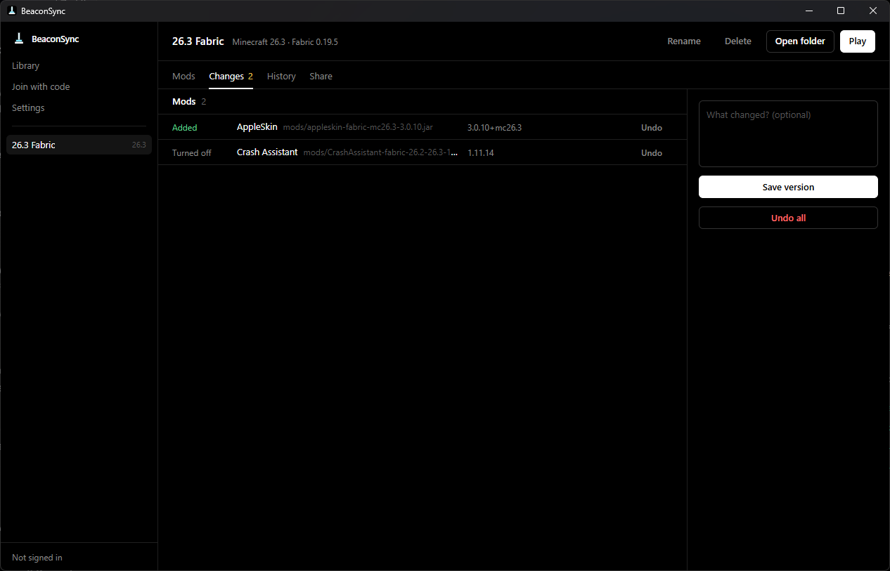 | 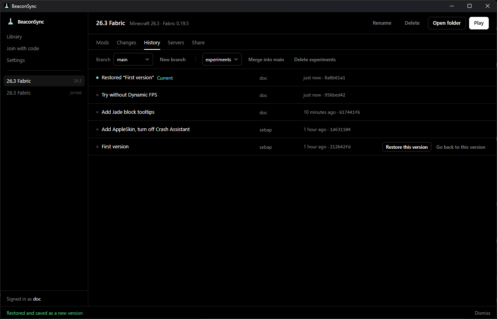 | 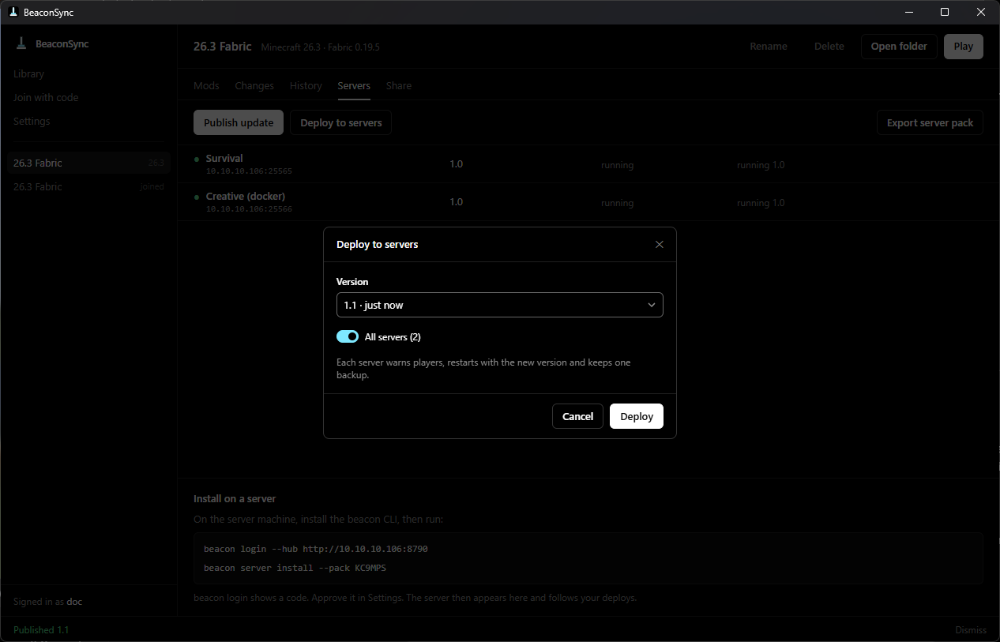 |

| In game: update available | In game: `/beacon pull` | Servers deploying 1.1 |
| --- | --- | --- |
| 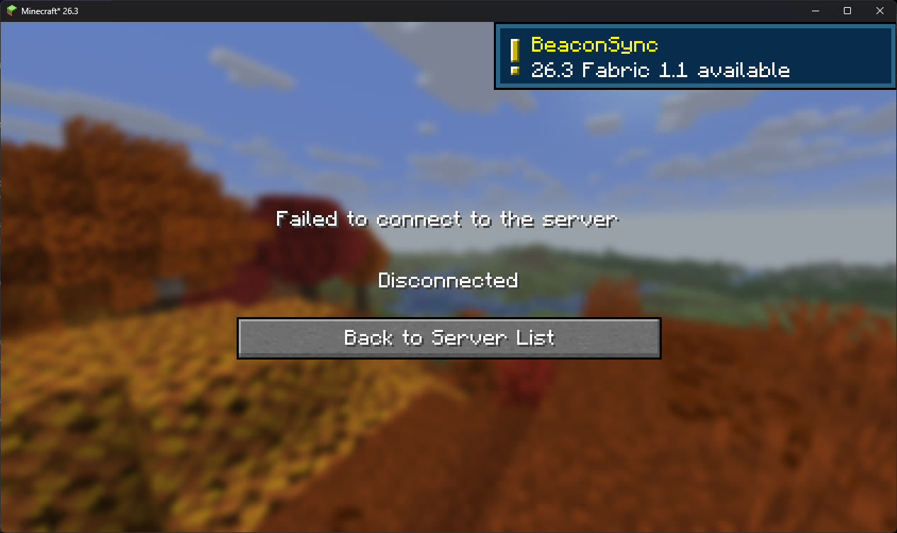 | 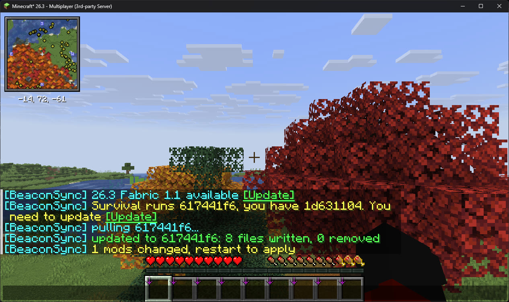 | 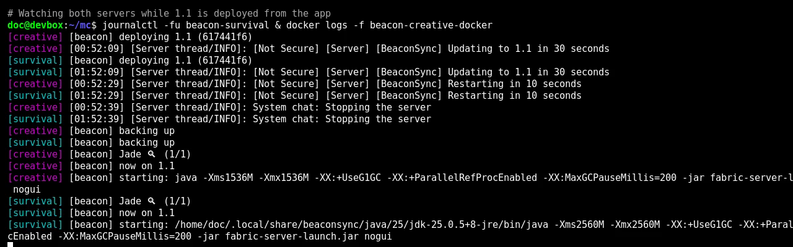 |

| Roll back for everyone | Servers rolling back |
| --- | --- |
| 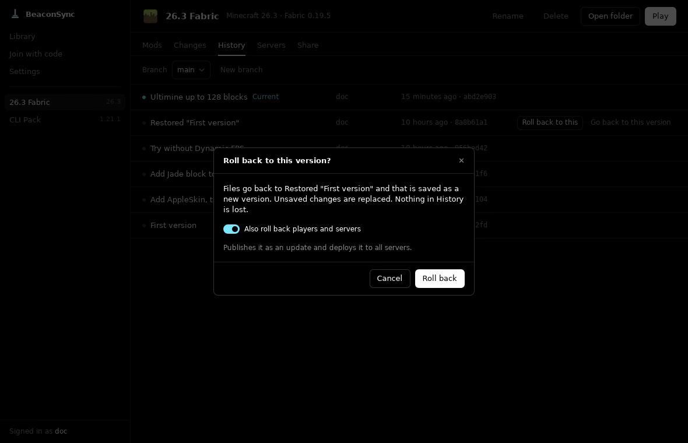 | 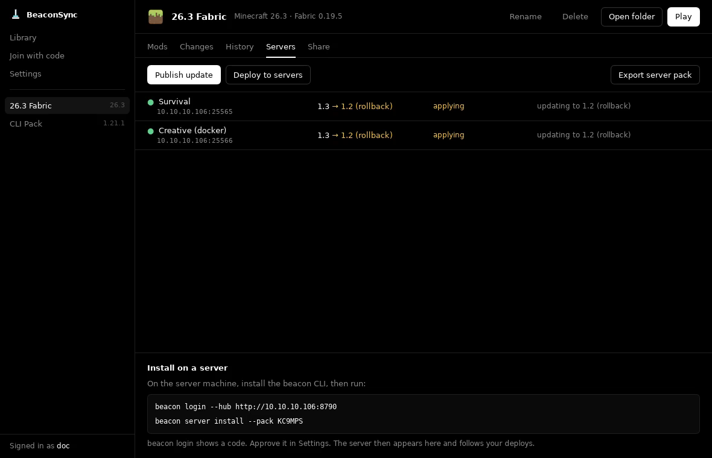 |

| Server console | Server backups (yours and mods') | Console in the terminal |
| --- | --- | --- |
| 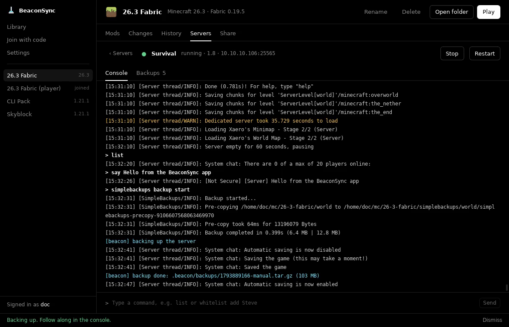 | 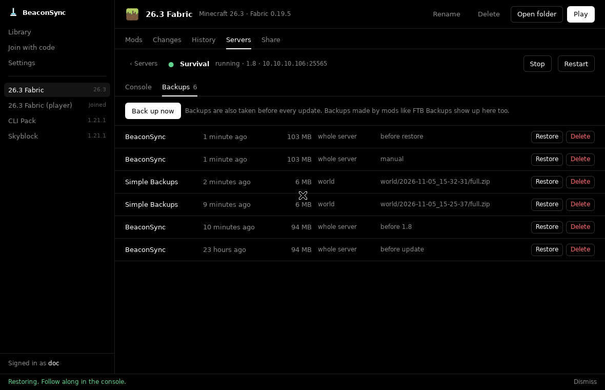 | 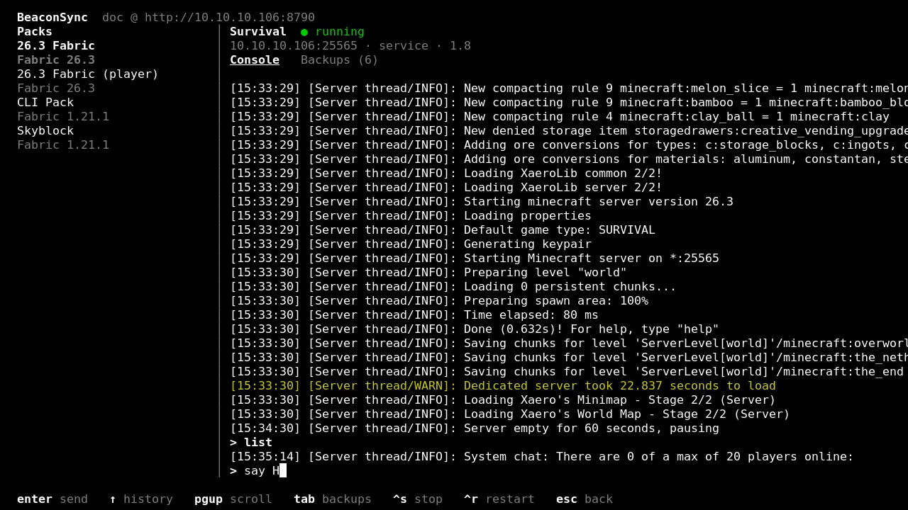 |

More in [docs/screenshots](docs/screenshots).

## What it does

- **Library like Prism Launcher.** Create packs (Vanilla, Fabric, Quilt, Forge, NeoForge), import
  `.mrpack`, CurseForge zips, Prism exports or existing Prism instances, browse Modrinth (and
  CurseForge with an API key). Your Prism instances show up in the library, ready to play.
- **Prism built in.** No separate launcher to install or open: Play downloads Prism the first
  time and starts the game directly. An installed Prism is used instead, with its accounts.
  Pick the Minecraft account from the sidebar; with the built-in Prism, add (only Microsoft's
  sign-in shows) and remove them there too, while an installed Prism manages its own. Set memory
  per pack, and crashes are reported in the app.
- **Versions like git.** See unsaved changes, undo them, save a version, view history, roll back
  to any version (for players and servers too: it is published and deployed), branches and merges. Mods are matched by project, so an updated mod shows
  as one change.
- **Upstream.** Copy (fork) someone's pack or a Modrinth modpack and later pull their new versions
  into yours with a three-way merge. Your own changes stay. Update single mods to newer Modrinth
  versions independently.
- **Server packs.** Export a ready-to-run server zip, or install straight onto a server with
  `beacon server install`: as a systemd **service** (boot start, crash restart, auto update), a
  **docker** container, or a **plain** folder with `start.sh`. Java and the loader are installed for you.
- **Deploys.** Publish a release from the app and deploy it to one, several or all servers. Each
  server warns players, stops cleanly, backs up, updates, restarts and reports back. A failed
  update rolls back automatically.
- **Server management.** From the app or the CLI, on any machine: watch the live console and send
  commands, start, stop and restart, and back up, restore or delete backups. Backups made by mods
  like FTB Backups or Simple Backups show up next to BeaconSync's own.
- **Updates.** The app updates itself from GitHub releases (download, verify, restart) and
  updates `beacon` on your servers with one click: each server checks the new build, warns
  players and restarts on it.
- **Players.** Friends join with a share code or link. The companion mod shows an in-game toast
  when an update is out, tells you if you match the server's version, and `/beacon pull` applies
  configs and resource packs live (mods are staged for the next restart). After a deploy players
  rejoin by themselves: the update is pulled while the server restarts.

## Pieces

| | |
| --- | --- |
| `apps/desktop` | Desktop app (Tauri 2 + React) |
| `crates/cli` | `beacon` CLI for servers and power users |
| `crates/hub` | `beacon-hub`, the self-hosted sync server |
| `crates/core` | Shared engine used by all of the above |
| `mods/companion-fabric` | In-game companion mod (Fabric 1.21.1 and 26.3) |

How it works: [docs/ARCHITECTURE.md](docs/ARCHITECTURE.md).

## Quick start

### 1. Run a hub

```sh
BEACON_HUB_PUBLIC_URL=https://hub.example.com docker compose -f docker/docker-compose.hub.yml up -d
```

or the published image: `docker run -d -p 8787:8787 -v hub-data:/data -e BEACON_HUB_PUBLIC_URL=https://hub.example.com ghcr.io/realdoc06/beacon-hub`,
or the binary: `beacon-hub --data ./hub-data --addr 0.0.0.0:8787`. Put it behind TLS for public use.

### 2. Make a pack in the app

Install the desktop app from Releases, set the hub URL in Settings, create an account, then
New pack → add mods → Save version → Publish. Share the code with friends.

### 3. Put it on a server

```sh
curl -L -o beacon https://github.com/RealDoc06/beaconsync/releases/latest/download/beacon-x86_64-unknown-linux-musl
chmod +x beacon
./beacon login            # shows a code; approve it in the app (Settings > Approve a device) or at <hub>/device
./beacon server install   # pick the pack, then service / docker / plain
./beacon server status    # version, backups, hub state
```

Already running a server? Bring it in instead of installing a new one:

```sh
./beacon server import /path/to/server   # its mods and configs become a pack, published as v1.0
```

The Minecraft version and loader are detected (pass `--mc` / `--loader` if not), the world and
server settings stay as they are, and nothing is downloaded over the existing files. If the old
server is still running, the import sets everything up but leaves starting the new one to you.

From now on, Deploy in the app updates the server. Manage it from the app (Servers › a server)
or from the CLI on any machine you are signed in on:

```sh
beacon server console -s Survival            # live console, type commands; tab for backups
beacon server cmd -s Survival whitelist add Steve
beacon server backups -s Survival            # BeaconSync's and backup mods' (FTB Backups, Simple Backups...)
beacon server backups -s Survival create | restore <id> | delete <id>
beacon server stop | start | restart -s Survival
beacon server rollback    # on the server, while it's stopped: back to the newest backup
```

Inside a server folder `-s` can be left out.

### CLI for pack authors

Run `beacon` with no command for a full screen UI: your packs on the left, changes, history,
branches and releases with live server status on the right. Save, roll back, publish, deploy,
update and play from the keyboard.

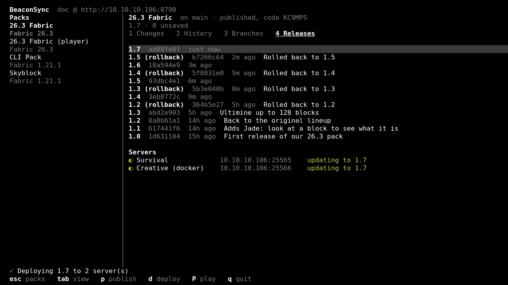

Every action is also a command that works inside any instance folder, like git:

```sh
beacon new "My Pack" --mc 1.21.1 --loader fabric
beacon add sodium               # Modrinth slug, pulls required dependencies
beacon status                   # unsaved changes
beacon save -m "Add Sodium"     # alias: commit
beacon log | branch | switch | merge | restore | reset | discard
beacon updates --apply          # newer Modrinth versions of your mods
beacon upstream --pull          # merge the pack you forked from
beacon publish v1.0 && beacon deploy
beacon rollback v1.0            # save v1.0 as a new version, publish and deploy it
beacon import --modrinth fabulously-optimized
beacon export server ./server.zip
```

## Building

Requirements: Rust (stable), Node 22 + pnpm, JDK 25 for the mod. On Linux also the
[Tauri system packages](https://v2.tauri.app/start/prerequisites/).

```sh
cargo build --release -p beacon-cli -p beacon-hub
cargo test --workspace
cd apps/desktop && pnpm install && pnpm tauri build
cd mods/companion-fabric && ./gradlew build
```

## Releasing

Push a `v*` tag. The Release workflow builds the CLI and hub, the desktop app (macOS universal,
signed and notarized; Windows and Linux on x64 and arm64), the companion mod and the
`ghcr.io/realdoc06/beacon-hub` image, then publishes the release. The Apple signing secrets live
in the repo's `release` environment, which only `v*` tags can use. `scripts/release-macos.sh`
still builds a signed macOS app by hand on a Mac.

## Notes

- Playing goes through [Prism Launcher](https://prismlauncher.org) (it handles Microsoft accounts,
  Java and game files): yours if installed, else a portable copy BeaconSync downloads on first play
  (its first run only asks you to sign in). BeaconSync instances are regular Prism instances with a
  `.beacon` folder.
- CurseForge needs your own API key (Settings), because CurseForge requires one per app.
- The in-game companion is Fabric only for now (Quilt loads it too), built for 1.21.1 and 26.3.

## License

MIT
