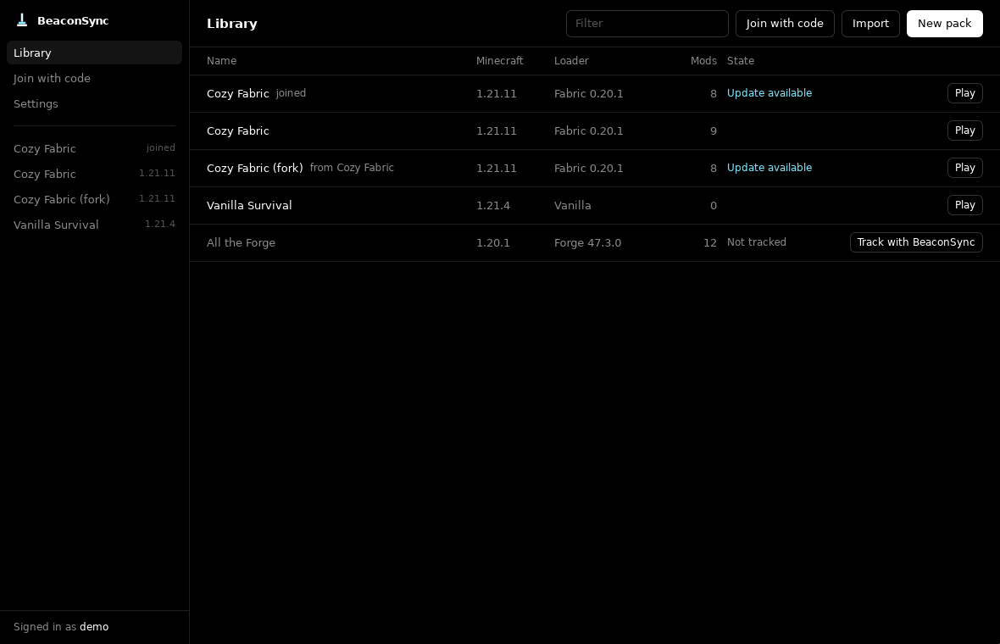
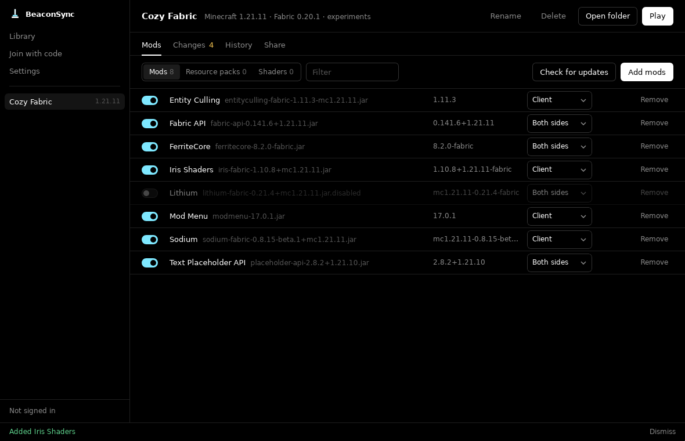
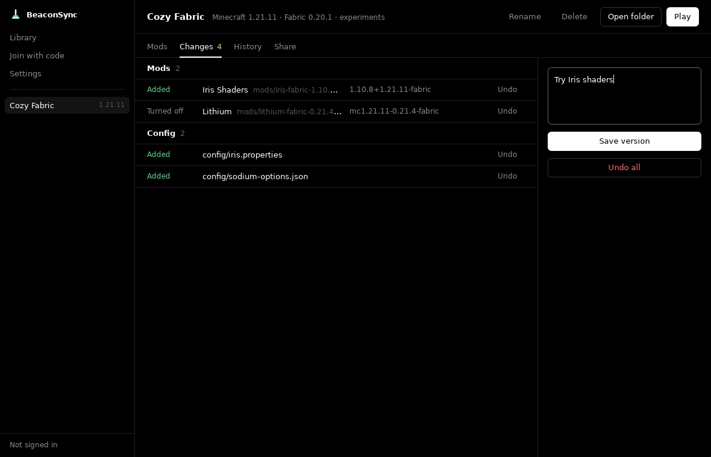
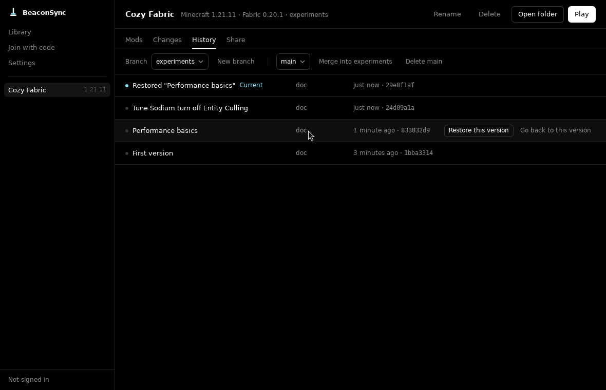

# BeaconSync

Git-like modpack manager for Minecraft. Build a pack, save versions, branch, roll back, publish,
and deploy it to one or many servers that update and restart themselves. Players get notified in
game when a new version is out.

> Alpha. Everything below works end to end, but expect rough edges. Please report bugs.



| Mods | Changes | History |
| --- | --- | --- |
|  |  |  |

## What it does

- **Library like Prism Launcher.** Create packs (Vanilla, Fabric, Quilt, Forge, NeoForge), import
  `.mrpack`, CurseForge zips, Prism exports or existing Prism instances, browse Modrinth (and
  CurseForge with an API key). Instances live in Prism's folder, so Prism launches them.
- **Versions like git.** See unsaved changes, undo them, save a version, view history, restore or
  go back to any version, branches and merges. Mods are matched by project, so an updated mod shows
  as one change.
- **Upstream.** Copy (fork) someone's pack or a Modrinth modpack and later pull their new versions
  into yours with a three-way merge. Your own changes stay. Update single mods to newer Modrinth
  versions independently.
- **Server packs.** Export a ready-to-run server zip, or install straight onto a server with
  `beacon server install`: as a systemd **service** (boot start, crash restart, auto update), a
  **docker** container, or a **plain** folder with `start.sh`. Java and the loader are installed for you.
- **Deploys.** Publish a release from the app and deploy it to one, several or all servers. Each
  server warns players, stops cleanly, keeps one backup, updates, restarts and reports back. A failed
  update rolls back automatically.
- **Players.** Friends join with a share code or link. The companion mod shows an in-game toast
  when an update is out, tells you if you match the server's version, and `/beacon pull` applies
  configs and resource packs live (mods are staged for the next restart).

## Pieces

| | |
| --- | --- |
| `apps/desktop` | Desktop app (Tauri 2 + React) |
| `crates/cli` | `beacon` CLI for servers and power users |
| `crates/hub` | `beacon-hub`, the self-hosted sync server |
| `crates/core` | Shared engine used by all of the above |
| `mods/companion-fabric` | In-game companion mod (Fabric 1.21.1) |

How it works: [docs/ARCHITECTURE.md](docs/ARCHITECTURE.md).

## Quick start

### 1. Run a hub

```sh
BEACON_HUB_PUBLIC_URL=https://hub.example.com docker compose -f docker/docker-compose.hub.yml up -d
```

or run the binary: `beacon-hub --data ./hub-data --addr 0.0.0.0:8787`. Put it behind TLS for public use.

### 2. Make a pack in the app

Install the desktop app from Releases, set the hub URL in Settings, create an account, then
New pack → add mods → Save version → Publish. Share the code with friends.

### 3. Put it on a server

```sh
curl -L -o beacon https://github.com/RealDoc06/beaconsync/releases/latest/download/beacon-x86_64-unknown-linux-musl
chmod +x beacon
./beacon login            # shows a code; approve it in the app (Settings > Approve a device) or at <hub>/device
./beacon server install   # pick the pack, then service / docker / plain
```

From now on, Deploy in the app updates the server.

### CLI for pack authors

The CLI works inside any instance folder, like git:

```sh
beacon new "My Pack" --mc 1.21.1 --loader fabric
beacon add sodium               # Modrinth slug, pulls required dependencies
beacon status                   # unsaved changes
beacon save -m "Add Sodium"     # alias: commit
beacon log | branch | switch | merge | restore | reset | discard
beacon updates --apply          # newer Modrinth versions of your mods
beacon upstream --pull          # merge the pack you forked from
beacon publish v1.0 && beacon deploy
beacon import --modrinth fabulously-optimized
beacon export server ./server.zip
```

## Building

Requirements: Rust (stable), Node 22 + pnpm, JDK 21 for the mod. On Linux also the
[Tauri system packages](https://v2.tauri.app/start/prerequisites/).

```sh
cargo build --release -p beacon-cli -p beacon-hub
cargo test -p beacon-core -p beacon-hub -p beacon-cli
cd apps/desktop && pnpm install && pnpm tauri build
cd mods/companion-fabric && ./gradlew build
```

## Notes

- Playing goes through [Prism Launcher](https://prismlauncher.org) (it handles Microsoft accounts
  and game files). BeaconSync instances are regular Prism instances with a `.beacon` folder.
- CurseForge needs your own API key (Settings), because CurseForge requires one per app.
- The in-game companion is Fabric only for now (Quilt loads it too).

## License

MIT
